### `$ cat about.md`

- 🛡️ Cybersecurity analyst in training: **Google Cybersecurity Certificate ✔**, **CompTIA Security+** in progress
- 🏦 Handled fraud reports at **RBC** and **EQ Bank**, now heading from the fraud desk to the SOC
- 📱 Built, launched and secured **2 live apps on Google Play**
- 🤖 Run my own AI agents with one rule: nothing gets bought, deleted or sent without my approval
- 🇨🇦 Toronto · bilingual English / French

### `$ ls ~/case-files`

| Project | What I secured | Link |
|---|---|---|
| **Jexsy** · Android app | Server-side API proxy, Supabase row-level security, DKIM/DMARC, PIPEDA-aligned privacy | [Google Play ↗](https://play.google.com/store/apps/details?id=com.jexsy.app) |
| **Flappy Dodo** · Android game | Anti-cheat run timer, abuse reporting, ad consent, signing keys in GitHub Actions secrets | [Google Play ↗](https://play.google.com/store/apps/details?id=com.flappydodo.extinctionrun2) |
| **AI Paper-Trading Lab** | Mapped to OWASP Top 10 for LLMs: LLM06 Excessive Agency, LLM05 Improper Output Handling | [Case study ↗](https://valerie-ingersin.jexsy.workers.dev/ai-guardrails.html) |

### `$ ./contact.sh`

